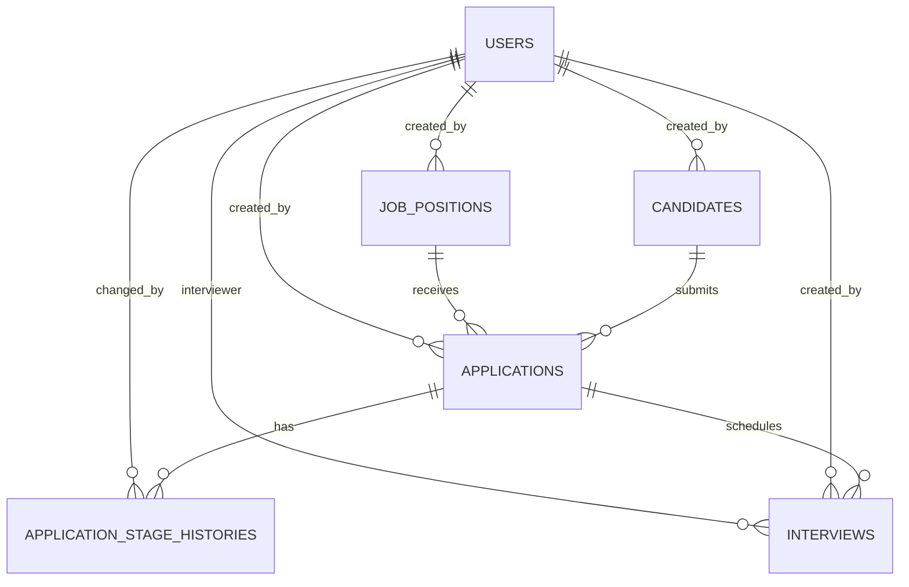
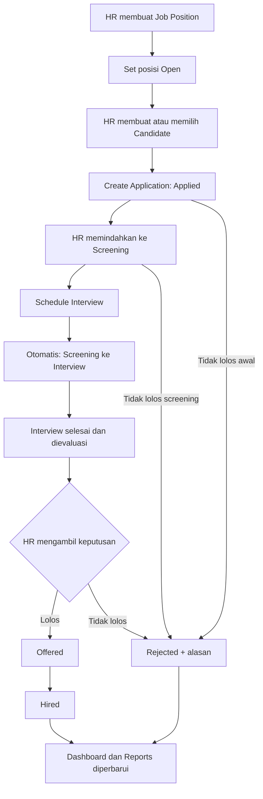

# TALENTORA — Functional Specification Document (FSD)

> **Recruitment Management & Applicant Tracking System (ATS)**  
> **Versi:** 1.1 — Baseline implementasi MVP  
> **Status:** Siap dijadikan acuan implementasi  
> **Bahasa:** Indonesia  
> **Stack:** Laravel 13+ REST API · Vue 3 · TypeScript · MySQL · Tailwind CSS · shadcn-vue · ApexCharts · Laravel Sanctum  
> **Jumlah menu/modul utama:** **Tepat 8**  
> **Prioritas:** Kebutuhan fungsional frontend, backend, database, dan pengujian. **Bukan** dokumen desain UI.

---

## Petunjuk penggunaan FSD untuk developer dan AI coding agent

1. **Baca seluruh dokumen sebelum menulis kode.** Jangan membuat asumsi hanya dari judul modul atau satu potongan spesifikasi.
2. **Pertahankan tepat delapan menu** pada [§3](#3-delapan-modul-utama). Login/logout merupakan fitur pendukung, **bukan menu kesembilan**.
3. **Implementasikan seluruh requirement ber-ID** (`G-xx`, `AUTH-xx`, `DASH-xx`, `JOB-xx`, `CAN-xx`, `APP-xx`, `PIPE-xx`, `INT-xx`, `REP-xx`, `SET-xx`, `DB-xx`, `API-xx`, `FE-xx`, `E2E-xx`). Gunakan ID tersebut saat membuat task dan test.
4. **Satu sumber kebenaran:** database + aturan workflow backend. Frontend tidak boleh menjadi satu-satunya pihak yang memvalidasi status, otorisasi, atau jadwal bentrok.
5. **Buat desain UI sendiri.** Dokumen ini menetapkan fungsi dan data, **tidak** menetapkan warna, layout, komponen visual, wireframe, atau bentuk navigasi.
6. **Jangan menambah fitur di luar cakupan MVP** tanpa keputusan eksplisit. Jangan menambah public career portal, candidate login, AI screening, notifikasi otomatis, payroll, deployment, Docker, dan sebagainya.
7. Bila menemukan ketidaksesuaian antara beberapa bagian, **aturan lebih spesifik pada bagian business rules/transition matrix menjadi acuan**. Catat gap sebelum mengubah keputusan domain.
8. Urutan implementasi yang dianjurkan: **schema & seed → auth & roles → Job Positions → Candidates → Applications → Hiring Pipeline → Interviews → Dashboard → Reports → Settings → E2E**. Settings dasar (seed admin/timezone) boleh disiapkan lebih awal sebagai fondasi.
9. Setiap endpoint harus memiliki **validasi, otorisasi, error handling, serta automated test** sesuai acceptance criteria.
10. Saat melaporkan progress, tampilkan **ID requirement yang selesai, yang belum selesai, blocker, dan bukti test**. Jangan menyatakan modul selesai bila acceptance criteria belum terpenuhi.

### Konvensi requirement

| Penanda | Arti |
|---|---|
| **WAJIB** | Harus tersedia untuk menyatakan MVP selesai. |
| **TIDAK DALAM MVP** | Dilarang dianggap sebagai requirement saat implementasi versi ini. |
| **Bebas desain** | Keputusan visual atau interaksi yang tidak mengubah aturan bisnis. |
| `id` | PK numerik internal (`BIGINT UNSIGNED`). |
| `code` | Identitas bisnis unik, tidak menggantikan primary key. |
| `*_at` | Timestamp kejadian; seluruh timestamp server disimpan dalam **UTC**. |

---

## Daftar isi

1. [Ringkasan proyek dan tujuan](#1-ringkasan-proyek-dan-tujuan)
2. [Ruang lingkup dan peran pengguna](#2-ruang-lingkup-dan-peran-pengguna)
3. [Delapan modul utama](#3-delapan-modul-utama)
4. [Modul 1 — Dashboard](#4-modul-1--dashboard)
5. [Modul 2 — Job Positions](#5-modul-2--job-positions)
6. [Modul 3 — Candidates](#6-modul-3--candidates)
7. [Modul 4 — Applications](#7-modul-4--applications)
8. [Modul 5 — Hiring Pipeline](#8-modul-5--hiring-pipeline)
9. [Modul 6 — Interview Schedule](#9-modul-6--interview-schedule)
10. [Modul 7 — Reports & Analytics](#10-modul-7--reports--analytics)
11. [Modul 8 — Settings](#11-modul-8--settings)
12. [Database specification](#12-database-specification)
13. [REST API contract](#13-rest-api-contract)
14. [End-to-end business workflow](#14-end-to-end-business-workflow)
15. [Frontend implementation requirements](#15-frontend-implementation-requirements)
16. [Backend implementation requirements](#16-backend-implementation-requirements)
17. [Validasi lintas modul dan edge cases](#17-validasi-lintas-modul-dan-edge-cases)
18. [Test plan dan acceptance scenarios](#18-test-plan-dan-acceptance-scenarios)
19. [Fase implementasi](#19-fase-implementasi)
20. [Definition of Done dan checklist rilis MVP](#20-definition-of-done-dan-checklist-rilis-mvp)
21. [Requirement traceability matrix](#21-requirement-traceability-matrix)
22. [Keputusan tetap dan hal di luar cakupan](#22-keputusan-tetap-dan-hal-di-luar-cakupan)

---

# 1. Ringkasan proyek dan tujuan

## 1.1 Deskripsi

**Talentora** merupakan aplikasi internal **Recruitment Management & Applicant Tracking System**. HR/Admin mengelola lowongan, data kandidat, lamaran, pipeline seleksi, interview, evaluasi, dan pelaporan dalam satu sistem. Kandidat tidak memiliki akun dan tidak mengakses Talentora secara langsung. Data kandidat dan application diinput oleh pengguna internal.

## 1.2 Tujuan

- **G-01** Memusatkan data lowongan, kandidat, dan lamaran; tidak ada data kandidat duplikat antar modul.
- **G-02** Menghubungkan setiap lamaran dengan tepat satu kandidat dan satu posisi pekerjaan.
- **G-03** Memastikan proses hiring dapat dilacak dari `Applied` sampai `Hired` atau `Rejected`.
- **G-04** Memastikan jadwal dan hasil interview terhubung ke lamaran yang benar.
- **G-05** Menampilkan ringkasan dan laporan berdasarkan query database nyata, bukan data statis.
- **G-06** Menyediakan akses internal berdasarkan role tanpa membangun sistem HRIS atau career portal.
- **G-07** Menghasilkan project portfolio yang fungsional, teruji, dan demonstrable melalui 8 menu saja.

## 1.3 Teknologi dan arsitektur

| Lapisan | Ketentuan |
|---|---|
| Backend | Laravel 13+; Controllers, Form Requests, Services, Policies, Eloquent, API Resources, Migrations, Seeders. |
| Frontend | Vue 3 Composition API + TypeScript (SPA), router, typed API client, state management sesuai kebutuhan. |
| Database | MySQL, InnoDB, foreign keys, unique constraints, indexes, transaksi. |
| Style | Tailwind CSS + shadcn-vue (**opsional untuk pilihan komponen**, desain visual ditentukan pengguna). |
| Charts | ApexCharts (pilihan library; chart harus menggunakan API nyata). |
| Authentication | Laravel Sanctum **cookie/session mode** untuk first-party SPA. |
| File | Laravel Filesystem; CV disimpan privat dan dikirim via endpoint terotorisasi. |
| Komunikasi | JSON REST API; request file menggunakan `multipart/form-data`. |

## 1.4 Prinsip domain

- **G-08** `Candidate` adalah identitas orang; `Application` adalah proses melamar **satu** posisi. Karena itu seorang kandidat bisa punya beberapa application dengan status berbeda.
- **G-09** Status `Job Position` (`draft/open/closed`) berbeda dari stage `Application` (`applied/.../rejected`).
- **G-10** Perubahan stage hanya dilakukan melalui satu **ApplicationWorkflowService** di backend, termasuk perubahan otomatis akibat penjadwalan interview.
- **G-11** Catatan riwayat stage bersifat **append-only** dari API biasa; tidak ada fitur mengedit/menghapus history.
- **G-12** Aplikasi **single-company** dan seluruh HR internal mengakses data recruitment yang sama.

---

# 2. Ruang lingkup dan peran pengguna

## 2.1 In scope

1. Login/logout dan profil pengguna internal.
2. Dua role tetap: `admin` dan `hr_staff`.
3. Tepat delapan modul §3.
4. CRUD operasional, filter/search/sort/pagination sesuai masing-masing modul.
5. Upload, ganti, lihat, unduh, hapus CV (private storage).
6. Workflow stage dengan audit history.
7. Jadwal interview, reschedule, cancel, complete, evaluation.
8. Dashboard, recruitment reports, dan settings dasar.
9. Validasi frontend dan backend, database constraints, test otomatis.

## 2.2 Out of scope

- Public career website/job board, candidate self-service, candidate login.
- Integrasi job portal/LinkedIn, email/WhatsApp/SMS otomatis, push notification.
- AI resume screening, ranking kandidat otomatis, OCR CV.
- Online skill test, video meeting internal, e-signature/offer letter.
- Employee onboarding, payroll, absensi, manajemen kontrak kerja.
- Multi-tenant/multi-company, role-permission dinamis, SSO, workflow builder.
- Import massal CSV/Excel, export PDF/Excel, dashboard realtime via WebSocket.
- Docker, CI/CD, server provisioning, production deployment, DevOps docs.

## 2.3 Role matrix

| Menu/aktivitas | `admin` | `hr_staff` |
|---|---|---|
| Dashboard | View | View |
| Job Positions | View/Create/Edit/Status/Delete bersyarat | Sama |
| Candidates | View/Create/Edit/Delete bersyarat/CV | Sama |
| Applications | View/Create/Edit metadata/Stage/History | Sama |
| Hiring Pipeline | View/Update stage/Reject | Sama |
| Interview Schedule | View/Create/Edit/Complete/Cancel | Sama |
| Reports & Analytics | View | View |
| Settings → My Profile | View/Edit profil sendiri/password | Sama |
| Settings → User Management | View/Create/Edit/Activate/Deactivate | **Tidak boleh** |
| Settings → Application Settings | View/Edit | **Tidak boleh** |

- **AUTH-01** Semua endpoint aplikasi, kecuali login dan persiapan CSRF Sanctum yang relevan, memerlukan sesi yang valid.
- **AUTH-02** Role divalidasi **di server**; menyembunyikan UI saja bukan pengamanan akses.
- **AUTH-03** User inactive tidak dapat login; request dari sesi yang masih aktif harus ditolak setelah akun dinonaktifkan.
- **AUTH-04** Logout mengakhiri sesi saat ini.
- **AUTH-05** User yang sudah login dapat mengakses identitas dirinya via `GET /api/me`.
- **AUTH-06** Tidak ada fitur registrasi publik. Admin awal dibuat melalui seeder lokal, lalu admin dapat membuat HR Staff pada Settings.
- **AUTH-07** User yang sudah dipakai dalam referensi historis tidak dihapus permanen; cukup nonaktifkan.
- **AUTH-08** Backend mengecek bahwa role aktif user masih valid pada request berikutnya setelah perubahan role.

## 2.4 Definisi status

| Entitas | Nilai | Makna |
|---|---|---|
| Job Position | `draft`, `open`, `closed` | Persiapan, menerima lamaran, tidak menerima lamaran baru. |
| Application | `applied`, `screening`, `interview`, `offered`, `hired`, `rejected` | Stage rekrutmen. |
| Interview | `scheduled`, `completed`, `cancelled` | Siklus interview. |
| User | `is_active = true/false` | Dapat/tidak dapat menggunakan aplikasi. |

Nilai string API/database menggunakan `snake_case` lowercase; label tampilan bebas mengikuti rancangan UI.

---

# 3. Delapan modul utama

| No. | Nama menu **persis** | Ringkasan |
|---:|---|---|
| 1 | **Dashboard** | Statistik, upcoming interviews, recent applications. |
| 2 | **Job Positions** | Kelola lowongan dan status posisi. |
| 3 | **Candidates** | Profil kandidat, CV, dan riwayat lamaran. |
| 4 | **Applications** | Kelola lamaran, metadata, stage dan history. |
| 5 | **Hiring Pipeline** | Tahapan rekrutmen dan transisi Kanban. |
| 6 | **Interview Schedule** | Jadwal, kalender, evaluasi, status interview. |
| 7 | **Reports & Analytics** | Funnel, tren, performa posisi, KPI. |
| 8 | **Settings** | Profil, user internal, company/timezone. |

**Larangan scope drift:** Department, interview evaluation, application history, user management, dan profile merupakan **fitur/subbagian** menu di atas, **bukan menu utama terpisah**.

---

# 4. Modul 1 — Dashboard

## 4.1 Tujuan dan data

Dashboard adalah read-only overview. Tidak ada CRUD pada menu ini.

| ID | Kebutuhan WAJIB |
|---|---|
| **DASH-01** | Tampilkan kartu **Total Candidates**: seluruh kandidat terdaftar (all-time). |
| **DASH-02** | Tampilkan **Active Job Positions**: jumlah posisi `open` saat ini (all-time state). |
| **DASH-03** | Tampilkan **Total Applications**: jumlah application dengan `applied_at` dalam periode terpilih. |
| **DASH-04** | Tampilkan **Upcoming Scheduled Interviews**: interview `scheduled` dengan `start_at >= now()` dalam 14 hari ke depan. Ini metrik upcoming, independen dari filter application. |
| **DASH-05** | Tampilkan **Hired Applications**: application dari periode terpilih yang **current stage** `hired`. Jangan menamai jumlah ini sebagai jumlah orang unik. |
| **DASH-06** | Tampilkan **Rejected Applications**: application dari periode terpilih yang **current stage** `rejected`. |
| **DASH-07** | Tampilkan distribusi stage untuk cohort application pada periode. |
| **DASH-08** | Tampilkan ringkasan aplikasi per Job Position untuk cohort periode. |
| **DASH-09** | Tampilkan paling banyak 5 upcoming interviews, terurut `start_at ASC`. |
| **DASH-10** | Tampilkan paling banyak 5 recent applications pada cohort periode, terurut `created_at DESC`. |
| **DASH-11** | Dukung filter `start_date` dan `end_date` untuk metrik berbasis `applied_at`. Kedua parameter wajib dikirim bersama jika salah satunya digunakan. |
| **DASH-12** | Semua metric berasal dari database; data kosong menghasilkan nol/list kosong, bukan error. |

**Periode default:** 30 hari kalender terakhir **termasuk hari ini** berdasarkan timezone aplikasi. Batas tanggal inklusif (`start_date <= applied_at <= end_date`). `start_date <= end_date`.

**Respons `GET /api/dashboard`:**

```json
{
  "data": {
    "period": {"start_date": "2026-11-01", "end_date": "2026-11-21"},
    "total_candidates": 120,
    "active_job_positions": 8,
    "total_applications": 31,
    "upcoming_scheduled_interviews": 4,
    "hired_applications": 6,
    "rejected_applications": 9,
    "stage_distribution": [{"stage": "applied", "total": 7}],
    "applications_by_position": [{"job_position_id": 1, "title": "Backend Developer", "total": 12}],
    "upcoming_interviews": [],
    "recent_applications": []
  }
}
```

Nilai di atas **ilustrasi bentuk JSON, bukan seed wajib**. `stage_distribution` wajib berisi keenam stage, termasuk yang `total=0`. Data `upcoming_interviews` mencakup identitas application, candidate, position, interviewer, dan waktu; `recent_applications` mencakup code, candidate, position, stage, applied_at.

**Acceptance:** **AC-DASH-01** nilai metrik cocok dengan query DB; **AC-DASH-02** filter inklusif bekerja; **AC-DASH-03** user tidak login menerima 401; **AC-DASH-04** kosong tidak error; **AC-DASH-05** upcoming tidak berisi `cancelled` atau tanggal lampau.

---

# 5. Modul 2 — Job Positions

## 5.1 Data dan operasi

| ID | Kebutuhan WAJIB |
|---|---|
| **JOB-01** | List posisi menampilkan `code`, `title`, `department`, `employment_type`, `location`, `openings`, `applicants_count`, `status`, `created_at`. |
| **JOB-02** | Search berdasarkan `code`/`title`; filter `department`, `employment_type`, `status`; pagination/sorting. |
| **JOB-03** | Create posisi dengan field wajib sesuai tabel di bawah. |
| **JOB-04** | Detail posisi termasuk data lengkap dan application terkait (paginated melalui list Applications dengan `job_position_id`). |
| **JOB-05** | Edit metadata posisi tanpa mengubah application yang sudah ada. |
| **JOB-06** | Ubah `status` menjadi `draft/open/closed` secara eksplisit. |
| **JOB-07** | Hapus posisi hanya bila **belum pernah** memiliki application. |
| **JOB-08** | `applicants_count` adalah jumlah **application** terkait, bukan jumlah unique person di database. |

### Field create/update

| Field | Tipe | Wajib | Validasi |
|---|---|---|---|
| `code` | string | Ya | 3–50 karakter, unik; `trim`, uppercase untuk konsistensi. |
| `title` | string | Ya | 3–200 karakter. |
| `department` | string | Ya | 2–150 karakter; **free text** (tidak ada menu Department). |
| `employment_type` | enum | Ya | `full_time`, `part_time`, `contract`, `internship`. |
| `location` | string | Ya | 2–200 karakter. |
| `openings` | integer | Ya | Minimal 1. |
| `description` | text | Ya | Nonblank. |
| `requirements` | text | Ya | Nonblank. |
| `status` | enum | Ya | `draft`, `open`, `closed`. |

### Business rules

- **JOB-09** Hanya posisi `open` yang boleh menerima **application baru**; posisi `closed` tetap dapat diproses sampai lamaran selesai.
- **JOB-10** Posisi `draft` tidak dapat menerima application.
- **JOB-11** Perubahan status posisi tidak mengubah stage application maupun interview.
- **JOB-12** Delete posisi ber-application mengembalikan `409 Conflict`, bukan cascade delete.
- **JOB-13** `code` tidak boleh duplikat, termasuk perbedaan kapitalisasi.
- **JOB-14** Status dapat berubah `draft ↔ open ↔ closed` (tidak ada approval tambahan pada MVP); posisi yang kembali open boleh menerima lamaran baru dengan tetap menaati unique candidate+position. Jumlah `openings` adalah informasi kebutuhan, **tidak otomatis menutup posisi atau memblokir application** saat jumlah Hired tercapai.

### Endpoint

`GET /api/job-positions` · `POST /api/job-positions` · `GET /api/job-positions/{id}` · `PATCH /api/job-positions/{id}` · `PATCH /api/job-positions/{id}/status` · `DELETE /api/job-positions/{id}`.

List query: `q`, `department`, `employment_type`, `status`, `sort_by` (`created_at`, `title`, `code`), `sort_dir`, `page`, `per_page`.

**Acceptance:** **AC-JOB-01** CRUD valid; **AC-JOB-02** code duplikat ditolak; **AC-JOB-03** closed/draft tidak bisa menerima lamaran; **AC-JOB-04** delete posisi yang sudah punya lamaran ditolak; **AC-JOB-05** pagination/filter sesuai.

---

# 6. Modul 3 — Candidates

## 6.1 Data dan operasi

| ID | Kebutuhan WAJIB |
|---|---|
| **CAN-01** | List kandidat: `full_name`, `email`, `phone`, `location`, `skills`, `applications_count`, `created_at`. |
| **CAN-02** | Search `full_name`/`email`; filter lokasi, sort, pagination. |
| **CAN-03** | Create kandidat tanpa memilih posisi (posisi dipilih pada Applications). |
| **CAN-04** | Edit kandidat tanpa mengubah identifier/referensi application. |
| **CAN-05** | Detail kandidat menampilkan profil, info profesional, CV, dan history aplikasi. |
| **CAN-06** | Upload/replace CV melalui endpoint file privat; validasi format dan ukuran. |
| **CAN-07** | Lihat/unduh CV melalui endpoint terproteksi. |
| **CAN-08** | Hapus CV tanpa menghapus kandidat/application. |
| **CAN-09** | Hapus kandidat hanya bila belum pernah memiliki application. |
| **CAN-10** | Satu kandidat boleh punya banyak lamaran ke **posisi berbeda**. |

### Field

| Field | Tipe | Wajib | Validasi |
|---|---|---|---|
| `full_name` | string | Ya | 2–150 karakter. |
| `email` | email | Ya | Maks. 255; trim + lowercase; unik case-insensitive. |
| `phone` | string | Ya | 6–30 karakter. |
| `location` | string/null | Tidak | Maks. 200. |
| `education` | string/null | Tidak | Maks. 200. |
| `years_experience` | integer/null | Tidak | 0–70. |
| `skills` | text/null | Tidak | Free text, maksimal 5.000 karakter; tidak ada master Skill. |
| `experience_summary` | text/null | Tidak | Maks. 10.000 karakter. |
| `linkedin_url` | URL/null | Tidak | URL HTTP(S), maks. 500. |
| `portfolio_url` | URL/null | Tidak | URL HTTP(S), maks. 500. |
| `cv` | file/null | Tidak | **PDF/DOC/DOCX, maks. 5 MiB** (`5 × 1024 × 1024` byte). |

### Business rules

- **CAN-11** `email` dinormalisasi lowercase sebelum disimpan; DB harus memakai collation/index unik yang konsisten dengan aturan ini.
- **CAN-12** Email kandidat yang sama tidak dapat dibuat ulang; gunakan kandidat yang sudah ada.
- **CAN-13** File CV berada pada disk private; **jangan** expose `cv_path` sebagai public URL.
- **CAN-14** Replace file menulis file baru lalu mengganti referensi metadata secara aman; file lama dibersihkan setelah update DB berhasil. Jika gagal, jangan meninggalkan referensi DB ke file yang tidak ada.
- **CAN-15** Nama file yang diunggah **tidak** digunakan langsung sebagai path server; pakai nama unik yang dibuat server.
- **CAN-16** Delete kandidat dengan application ditolak `409`; riwayat tidak boleh terhapus.
- **CAN-17** `applications_count` menghitung application, bukan unique position aktif saja.
- **CAN-18** Metadata dibuat via JSON pada `POST /api/candidates`; upload CV merupakan **request terpisah** setelah kandidat memiliki `id`. Jika upload gagal, record kandidat tetap ada dan frontend menampilkan kegagalan upload dengan jelas.

### Endpoint

`GET /api/candidates` · `POST /api/candidates` · `GET /api/candidates/{id}` · `PATCH /api/candidates/{id}` · `DELETE /api/candidates/{id}` · `POST /api/candidates/{id}/cv` · `GET /api/candidates/{id}/cv` · `DELETE /api/candidates/{id}/cv`.

List query: `q`, `location`, `sort_by` (`created_at`, `full_name`), `sort_dir`, `page`, `per_page`.

`POST /cv`: multipart field `cv`. `GET /cv`: stream file dengan MIME yang benar, `Content-Disposition` download atau inline sesuai dukungan file; hasil 404 jika belum ada CV. Path file privat tidak dikirim ke frontend.

**Acceptance:** **AC-CAN-01** CRUD; **AC-CAN-02** email duplikat ditolak case-insensitive; **AC-CAN-03** format/size CV invalid ditolak; **AC-CAN-04** CV hanya dapat diakses internal; **AC-CAN-05** delete terblokir jika punya application; **AC-CAN-06** kandidat bisa melamar posisi berbeda.

---
# 7. Modul 4 — Applications

## 7.1 Konsep

Satu `Application` = satu kandidat melamar satu job position. Data master kandidat dan posisi **tidak disalin** ke tabel Applications. Kandidat yang sama dapat memiliki status berbeda pada dua posisi berbeda.

| ID | Kebutuhan WAJIB |
|---|---|
| **APP-01** | List berisi `application_code`, candidate, job position, department, `applied_at`, `source`, `stage`, `updated_at`. |
| **APP-02** | Search candidate/code; filter job position, stage, tanggal applied; sorting, pagination. |
| **APP-03** | Create application dengan candidate yang ada dan job position `open`. |
| **APP-04** | Backend menghasilkan `application_code` unik saat create; client **tidak** menentukan kode. |
| **APP-05** | Application selalu dibuat pada `stage=applied`; initial history `NULL → applied` tersimpan. |
| **APP-06** | Detail berisi metadata lamaran, profil kandidat, posisi, stage history, interview history. |
| **APP-07** | Edit hanya `source`, `applied_at`, `notes` untuk lamaran yang belum terminal. |
| **APP-08** | Ubah stage via endpoint **yang sama** dengan Hiring Pipeline, tidak boleh update lewat endpoint edit metadata. |
| **APP-09** | Riwayat stage read-only, urut `changed_at DESC, id DESC`. |
| **APP-10** | Tidak ada fitur Delete Application pada MVP untuk menjaga audit trail. |

### Field create/update

| Field | Tipe | Wajib | Validasi |
|---|---|---|---|
| `candidate_id` | bigint | Create | Candidate harus ada. **Immutable setelah create.** |
| `job_position_id` | bigint | Create | Position harus ada dan `open`. **Immutable setelah create.** |
| `source` | enum | Ya | `manual`, `referral`, `job_portal`, `other`. |
| `applied_at` | `YYYY-MM-DD` | Ya | Tanggal valid, tidak setelah hari ini dalam timezone aplikasi. |
| `notes` | text/null | Tidak | Maks. 10.000 karakter. |

### Business rules

- **APP-11** Kombinasi `(candidate_id, job_position_id)` unik di **DB** dan backend. Tidak ada re-application pada posisi sama di MVP, termasuk jika sebelumnya rejected.
- **APP-12** Kandidat dan job position tidak dapat diganti setelah application dibuat.
- **APP-13** `application_code` dibentuk server sebagai `APP-<ULID>` (maks. 50 karakter) dan diberi unique index; tidak memerlukan tabel counter terpisah.
- **APP-14** Stage awal selalu `applied` tanpa override dari input frontend.
- **APP-15** Tidak boleh mengubah metadata pada stage terminal `hired`/`rejected` (read-only setelah keputusan akhir).
- **APP-16** `stage_updated_at` mencatat waktu transisi terakhir; `hired_at`/`rejected_at` diisi tepat saat memasuki terminal stage.
- **APP-17** Edit applied date **tidak** mengubah created_at/stage history. Jika sudah ada `hired_at`, edit metadata telah dilarang oleh APP-15.
- **APP-18** Unique constraint/FK harus menjadi pelindung terakhir saat dua request create terjadi serentak (duplikat → `409`).
- **APP-19** Update metadata tidak dapat menyisipkan field yang hanya boleh diubah workflow (`stage`, `hired_at`, `rejected_at`, `rejection_reason`).

### Endpoint

`GET /api/applications` · `POST /api/applications` · `GET /api/applications/{id}` · `PATCH /api/applications/{id}` · `PATCH /api/applications/{id}/stage` · `GET /api/applications/{id}/history`.

List query: `q`, `candidate_id`, `job_position_id`, `stage`, `start_date`, `end_date`, `sort_by` (`applied_at`, `created_at`, `updated_at`), `sort_dir`, `page`, `per_page`.

### Contoh create

```json
{
  "candidate_id": 15,
  "job_position_id": 4,
  "source": "referral",
  "applied_at": "2026-11-20",
  "notes": "Recommended by internal team"
}
```

**Acceptance:** **AC-APP-01** create dari posisi open; **AC-APP-02** duplikat kandidat-posisi ditolak; **AC-APP-03** stage awal + history benar; **AC-APP-04** update metadata tidak bisa mengubah stage; **AC-APP-05** terminal application read-only; **AC-APP-06** detail memuat histories dan interviews.

---

# 8. Modul 5 — Hiring Pipeline

## 8.1 Stage dan aturan transisi

**Tahapan linear utama:** `applied → screening → interview → offered → hired`; dari setiap stage non-terminal dapat memilih `rejected`.

| Stage saat ini | Stage tujuan yang diizinkan | Syarat tambahan |
|---|---|---|
| `applied` | `screening`, `rejected` | Reject wajib alasan. |
| `screening` | `interview`, `rejected` | `interview` terjadi **otomatis** saat interview pertama berhasil dijadwalkan; tidak dapat diubah manual. |
| `interview` | `offered`, `rejected` | `offered`: minimal satu interview `completed` **dengan evaluasi lengkap**, dan tidak ada interview `scheduled`. |
| `offered` | `hired`, `rejected` | Tidak boleh ada interview `scheduled`; reject wajib alasan. |
| `hired` | — | Terminal: tidak boleh ada transisi. |
| `rejected` | — | Terminal: tidak boleh ada transisi. |

> **Keputusan penting:** agar stage `interview` tidak bisa muncul tanpa jadwal, satu-satunya cara `screening → interview` adalah keberhasilan `POST /api/interviews`. Perubahan tersebut tetap wajib melewati ApplicationWorkflowService dan stage history.

## 8.2 Fitur

| ID | Kebutuhan WAJIB |
|---|---|
| **PIPE-01** | Menyediakan grouped application data per enam stage. |
| **PIPE-02** | Data kartu application: `id`, code, candidate, position, applied date, current stage, update timestamp. |
| **PIPE-03** | Filter berdasarkan job position dan search nama kandidat/code. |
| **PIPE-04** | UI dapat memakai Kanban drag-and-drop **atau** pilihan stage; aksi harus mengikuti aturan yang sama. |
| **PIPE-05** | Semua transisi manual memakai `PATCH /api/applications/{id}/stage`. |
| **PIPE-06** | Backend menolak stage mundur, stage skip, dan transisi terminal. |
| **PIPE-07** | Reject dari non-terminal memerlukan `note` sebagai alasan yang tidak kosong. |
| **PIPE-08** | Saat Rejected, interview yang masih `scheduled` untuk application tersebut otomatis menjadi `cancelled` dalam transaksi sama. |
| **PIPE-09** | Transisi stage dan insert history berlangsung **atomik**. |
| **PIPE-10** | Jika aplikasi berubah sejak user memuat data, API menolak request stale dengan 409. |
| **PIPE-11** | Setelah perubahan berhasil, Applications, Pipeline, Dashboard, Reports menampilkan state backend terbaru. |
| **PIPE-12** | Rejection dan Hired mengisi `rejected_at`/`hired_at` masing-masing. |
| **PIPE-13** | Server menyimpan `changed_by` dan `changed_at` untuk setiap transisi termasuk transisi otomatis via penjadwalan. |

### Request perubahan stage

```http
PATCH /api/applications/101/stage
Content-Type: application/json
```

```json
{
  "from_stage": "applied",
  "to_stage": "screening",
  "note": "CV memenuhi persyaratan minimum"
}
```

Untuk `to_stage=rejected`, `note` **wajib** dan disalin ke `applications.rejection_reason`; untuk transisi lain `note` opsional. `from_stage` **wajib** untuk manual update sebagai optimistic concurrency check. `to_stage=interview` melalui endpoint ini ditolak `422`; sistem menjadwalkan interview melalui endpoint Interview Schedule.

### Transaksi dan race condition

- **PIPE-14** Baca application dengan row lock/atomic conditional update; verifikasi persisted stage sama dengan `from_stage`; jika tidak, kembalikan 409 dan stage terbaru pada payload error yang aman.
- **PIPE-15** Untuk `interview → offered`, periksa completed interview + tidak ada scheduled interview di transaksi yang konsisten.
- **PIPE-16** Jika dua aksi transisi bersaing, paling banyak satu transisi sukses dari state awal yang sama; tidak boleh muncul duplikat history untuk satu perubahan.
- **PIPE-17** Saat reject, pembatalan interview scheduled dan history stage dijalankan dalam satu unit transaksi. Jangan kirim notifikasi (di luar MVP).
- **PIPE-18** Endpoint stage tidak boleh menerima mass-assignment field lain selain `from_stage`, `to_stage`, `note`.

### Endpoint

`GET /api/pipeline` (query: `job_position_id`, `q`) dan `PATCH /api/applications/{id}/stage` (shared endpoint).

`GET /api/pipeline` mengembalikan **keenam group**, masing-masing dengan array applications dan `total`; untuk dataset besar, endpoint harus mendukung pembatasan/pagination per stage atau hasil ringkas dengan batas yang dinyatakan (`limit_per_stage`, default 50, maksimal 100). `total` selalu menyatakan jumlah tanpa batas tampilan. Frontend dapat mengambil halaman lanjutan dari `GET /api/applications?stage=...`.

**Acceptance:** **AC-PIPE-01** stage transition matrix tepat; **AC-PIPE-02** skip/backward/terminal ditolak; **AC-PIPE-03** reject menyimpan alasan dan cancel scheduled interviews; **AC-PIPE-04** history tepat satu per perubahan; **AC-PIPE-05** race ditolak 409; **AC-PIPE-06** status aplikasi konsisten antar menu.

---

# 9. Modul 6 — Interview Schedule

## 9.1 Data dan fitur

| ID | Kebutuhan WAJIB |
|---|---|
| **INT-01** | List: candidate, position, interviewer, date/start/end, mode, status; search/filter/sort/pagination. |
| **INT-02** | Create interview untuk application pada `screening` atau `interview`. |
| **INT-03** | Interviewer dipilih dari user internal dengan `is_active=true` (admin atau hr_staff). |
| **INT-04** | Mode `online` mewajibkan `meeting_link`; `onsite` mewajibkan `location`. |
| **INT-05** | Jadwal baru harus di masa depan dan `end_at > start_at`. |
| **INT-06** | Tidak boleh ada **overlap** interview `scheduled` pada interviewer yang sama. |
| **INT-07** | Pada MVP satu application boleh memiliki banyak interview historis, tetapi **maksimal satu interview `scheduled` aktif sekaligus**. |
| **INT-08** | Ketika pertama kali dibuat pada application `screening`, aplikasi otomatis berpindah ke `interview` beserta history. |
| **INT-09** | Edit/reschedule hanya untuk interview `scheduled`; cek konflik lagi. |
| **INT-10** | Complete hanya dari `scheduled` ketika waktu selesai interview telah berlalu, dengan rating, recommendation, dan feedback lengkap. |
| **INT-11** | Cancel hanya dari `scheduled`. Terminal interview tidak bisa diedit/dibuka lagi. |
| **INT-12** | Jika perlu interview tambahan, buat record baru pada application yang masih di stage `interview`. |
| **INT-13** | Calendar endpoint menyediakan event dalam rentang waktu agar frontend bebas memilih tampilan kalender. |
| **INT-14** | Detail Application menampilkan seluruh interview, termasuk completed/cancelled. |
| **INT-15** | Evaluation recommendation hanya informasi HR; bukan approval otomatis untuk `offered`. |

### Field create/update interview

| Field | Tipe | Wajib | Validasi |
|---|---|---|---|
| `application_id` | bigint | Create | Application ada, stage `screening`/`interview`. Immutable setelah create. |
| `interviewer_id` | bigint | Ya | User ada dan active. |
| `start_at` | ISO 8601 timezone-aware | Ya | Di masa depan; dikonversi ke UTC. |
| `end_at` | ISO 8601 timezone-aware | Ya | Harus setelah `start_at`. |
| `mode` | enum | Ya | `online`, `onsite`. |
| `meeting_link` | URL/null | Conditional | Wajib jika `online`; URL HTTP(S) maks. 500. |
| `location` | string/null | Conditional | Wajib jika `onsite`; maks. 255. |
| `notes` | text/null | Tidak | Maks. 10.000. |

### Field evaluation ketika complete

| Field | Tipe | Validasi |
|---|---|---|
| `rating` | integer | 1–5, wajib. |
| `recommendation` | enum | `recommended`, `not_recommended`, `hold`, wajib. |
| `feedback` | text | Wajib nonblank; maks. 10.000 karakter. |

### Interview status transitions

| From | To | Aturan |
|---|---|---|
| `scheduled` | `completed` | `end_at <= now()`, evaluation wajib. |
| `scheduled` | `cancelled` | Dapat dibatalkan manual atau otomatis saat application rejected. |
| `completed` | — | Terminal. |
| `cancelled` | — | Terminal. |

### Penanganan konflik jadwal

Interval `[start_at, end_at)` menggunakan **start inklusif, end eksklusif**. Interview A dan B overlap apabila:

```text
A.start_at < B.end_at AND A.end_at > B.start_at
```

Jadwal yang bersentuhan tepat di batas (`A.end_at == B.start_at`) **tidak** bentrok. Query hanya mempertimbangkan interview dengan `status=scheduled`. Saat reschedule, exclude `id` interview yang sedang diubah.

- **INT-16** Konflik interviewer mengembalikan `409 Conflict` dengan pesan jelas.
- **INT-17** Dua request scheduling serentak untuk interviewer yang sama tidak boleh lolos jika hasilnya overlap; serialisasikan pemeriksaan lewat transaction + lock pada row interviewer (atau mekanisme DB setara) sebelum insert.
- **INT-18** Dua jadwal `scheduled` untuk application yang sama tidak boleh lolos meskipun interviewernya berbeda; validasi dalam transaksi dengan lock application.
- **INT-19** Jika scheduling gagal, stage application tetap `screening` dan tidak boleh ada history `screening → interview` yatim.
- **INT-20** Jika interviewer dinonaktifkan kemudian, interview existing tetap tersimpan untuk histori; **reschedule yang mengubah data** wajib memilih interviewer aktif.
- **INT-21** Jika interview rescheduled, datetime lama tidak diperlukan sebagai audit terpisah untuk MVP; update `updated_at` dan pertahankan identitas record.
- **INT-22** `completed` dapat dilakukan oleh HR/Admin internal, tidak wajib user yang sama dengan interviewer. Jika interview Scheduled dibatalkan secara manual, stage application **tetap `interview`**; HR dapat menjadwalkan interview baru atau reject, namun tidak boleh ke Offered sebelum ada evaluasi completed.

### Endpoint

| Method | Path | Penjelasan |
|---|---|---|
| GET | `/api/interviews` | List, filters, pagination. |
| POST | `/api/interviews` | Schedule. |
| GET | `/api/interviews/{id}` | Detail. |
| PATCH | `/api/interviews/{id}` | Edit/reschedule (scheduled only). |
| PATCH | `/api/interviews/{id}/complete` | Complete + evaluation. |
| PATCH | `/api/interviews/{id}/cancel` | Cancel. |
| GET | `/api/interviews/calendar` | Calendar events (range). |

List filters: `q`, `application_id`, `job_position_id`, `interviewer_id`, `status`, `start_date`, `end_date`, `sort_by` (`start_at`, `created_at`), `sort_dir`, `page`, `per_page`.

Calendar query: `start_at`, `end_at` (ISO 8601 UTC/timezone-aware, **dua-duanya wajib**). Rentang maksimal 93 hari untuk membatasi hasil. Kembalikan event bertimestamp ISO 8601 UTC, title/label kandidat dan posisi, serta status. Event `cancelled` tetap tersedia jika frontend ingin menampilkannya; filtering event berdasarkan status dapat digunakan.

### Contoh create

```json
{
  "application_id": 101,
  "interviewer_id": 2,
  "start_at": "2026-11-25T09:00:00+07:00",
  "end_at": "2026-11-25T10:00:00+07:00",
  "mode": "online",
  "meeting_link": "https://meet.example.com/interview-101",
  "notes": "Technical interview"
}
```

### Contoh complete

```json
{
  "rating": 4,
  "recommendation": "recommended",
  "feedback": "Problem solving and communication meet expectations."
}
```

**Acceptance:** **AC-INT-01** scheduling valid; **AC-INT-02** interview pertama memindahkan Screening→Interview; **AC-INT-03** conflict interviewer dan active interview per application ditolak; **AC-INT-04** reschedule only scheduled; **AC-INT-05** complete membutuhkan waktu selesai + evaluasi; **AC-INT-06** completed/cancelled terminal; **AC-INT-07** calendar memberikan event rentang benar; **AC-INT-08** schedule gagal tidak mengubah application.

---

# 10. Modul 7 — Reports & Analytics

## 10.1 Definisi cohort dan filter

Seluruh metrik **berbasis application** menggunakan *cohort*: application dengan `applied_at` berada pada periode `[start_date, end_date]` inklusif, kemudian dikelompokkan menurut **current stage**. Report interview menggunakan `start_at` pada periode tanggal di timezone aplikasi. `department` dibaca dari `job_positions.department` (bukan master lain).

Periode default = 30 hari kalender terakhir termasuk hari ini. Semua endpoint menerima `start_date`, `end_date`, `job_position_id`, `department` bila relevan; kedua tanggal harus dikirim bersama, atau sama-sama tidak dikirim.

| ID | Kebutuhan WAJIB |
|---|---|
| **REP-01** | Summary: total applications (cohort), hired (current), rejected (current), interviews completed pada interval, active `open` positions (state saat ini). |
| **REP-02** | Stage distribution menampilkan enam stage (termasuk jumlah 0). |
| **REP-03** | Application trends: grouping `daily`, `weekly`, `monthly` berdasarkan `applied_at` dan rentang filter. |
| **REP-04** | Job position performance: position, total applications, in progress, hired, rejected. **Posisi tanpa lamaran tetap dapat muncul dengan hitungan 0**, sesuai filter posisi/departemen. |
| **REP-05** | Hiring Rate = `hired_applications / total_applications * 100`, gunakan cohort yang sama. Jika denominator 0, hasil 0. |
| **REP-06** | Average Time to Hire = rerata selisih (`hired_at` dikurangi awal hari lokal `applied_at`) dalam **hari** untuk application cohort yang current stage `hired`. Jika tidak ada hired, hasil `null` (bukan 0 hari). |
| **REP-07** | Tampilkan minimal: summary, funnel/stage distribution, tren applications, position performance, KPI Hiring Rate/Time to Hire. |
| **REP-08** | Filters report diterapkan konsisten pada seluruh metric **yang memakai cohort application**. |
| **REP-09** | Positions `open` dihitung berdasarkan state saat ini, tidak dibatasi `applied_at`. Filter job position/department tetap berlaku pada metric posisi. |
| **REP-10** | Reports tidak menyediakan export PDF/Excel pada MVP. |
| **REP-11** | Angka berasal dari query DB yang benar; tidak menggunakan chart dummy hard-coded setelah API tersambung. |

### Rumus dan definisi detail

```text
cohort = applications where applied_at BETWEEN start_date AND end_date
         [and job_position_id filter] [and department filter]

in_progress = count(stage IN ['applied', 'screening', 'interview', 'offered'])

hiring_rate_percent = total_hired_in_cohort / total_cohort * 100
                      (0 jika total_cohort = 0)

average_time_to_hire_days = AVG(
  (hired_at_utc - local_start_of_day(applied_at, app_timezone)_as_utc)
  in seconds / 86400
)
for current-stage-hired application in cohort
(null jika tidak ada hired)
```

Round `hiring_rate_percent` dan `average_time_to_hire_days` menjadi 2 desimal pada API. Jangan gunakan `created_at` sebagai pengganti `applied_at` pada cohort.

### Endpoint

| Method | Path | Data |
|---|---|---|
| GET | `/api/reports/summary` | Summary metrics. |
| GET | `/api/reports/stages` | Counts per stage. |
| GET | `/api/reports/trends` | `group_by=daily\|weekly\|monthly`; date series. |
| GET | `/api/reports/positions` | Position performance, paginated. |
| GET | `/api/reports/metrics` | Hiring rate, average time to hire. |

Response stage menggunakan `{stage, total}`; trend `{period, total}`; positions `{job_position_id, title, department, total, in_progress, hired, rejected}`.

**Acceptance:** **AC-REP-01** hasil cocok manual DB fixture; **AC-REP-02** application multijob dihitung per lamaran; **AC-REP-03** filter konsisten; **AC-REP-04** no-data edge case; **AC-REP-05** time-to-hire dan hiring-rate benar; **AC-REP-06** grouping daily/weekly/monthly stabil.

---

# 11. Modul 8 — Settings

## 11.1 Subfitur

> **Settings tetap SATU menu utama.** `My Profile`, `User Management`, dan `Application Settings` hanya subbagian pada halaman Settings.

| ID | Kebutuhan WAJIB |
|---|---|
| **SET-01** | Setiap user dapat melihat/mengubah `name`, `email` miliknya sendiri. |
| **SET-02** | Setiap user dapat mengubah password dengan `current_password` yang valid. |
| **SET-03** | Hanya admin dapat melihat daftar user dan membuat user baru. |
| **SET-04** | Hanya admin dapat mengubah `name`, `email`, `role`, `is_active` user lain. |
| **SET-05** | Hanya admin dapat mengaktifkan atau menonaktifkan akun. |
| **SET-06** | Hanya admin dapat melihat/mengubah `company_name` dan `timezone`. |
| **SET-07** | Admin tidak boleh menonaktifkan dirinya sendiri atau menonaktifkan/demote admin aktif terakhir. |
| **SET-08** | HR Staff mendapat 403 saat mengakses endpoint User Management / Application Settings. |
| **SET-09** | Tidak tersedia hard delete user pada MVP. |
| **SET-10** | Email user unik, dinormalisasi lowercase, dan divalidasi case-insensitive. |

### Profil

- `name`: wajib, 2–150 karakter.
- `email`: wajib, email valid, maks. 255, unik di users.
- `current_password`: wajib untuk ganti password.
- `new_password`: minimal 8 karakter; wajib konfirmasi.

### Manajemen user

| Field | Create | Edit | Rule |
|---|---|---|---|
| `name` | Required | Optional | 2–150 char. |
| `email` | Required | Optional | Valid, unique. |
| `password` | Required | — | Min. 8; tidak dikembalikan pada API. |
| `role` | Required | Optional | `admin` / `hr_staff`. |
| `is_active` | Default true | Melalui endpoint status | Boolean. |

Jika admin ingin mengganti password user lain, fitur tersebut **tidak** disediakan dalam MVP. User mengganti password sendiri lewat My Profile.

### Pengaturan aplikasi

| Key | Tipe | Aturan |
|---|---|---|
| `company_name` | string | Wajib; 2–200 karakter. |
| `timezone` | string | Wajib, valid IANA timezone; default `Asia/Jakarta`. |

- **SET-11** Semua timestamp internal tetap UTC walaupun timezone setting berubah; frontend menampilkan tanggal/jam sesuai timezone yang tersimpan.
- **SET-12** `app_settings` hanya menyimpan whitelist dua key ini pada MVP; request key asing ditolak.
- **SET-13** Akun inactive segera ditolak pada request terautentikasi berikutnya, termasuk jika cookie sesi masih ada.
- **SET-14** Saat demote admin, validasi jumlah admin aktif harus atomik supaya dua admin tidak bisa saling mendemote secara bersamaan hingga tersisa nol.

### Endpoint

| Method | Path | Role |
|---|---|---|
| GET | `/api/me` | Authenticated |
| PATCH | `/api/me` | Authenticated |
| PATCH | `/api/me/password` | Authenticated |
| GET | `/api/users` | Admin |
| POST | `/api/users` | Admin |
| PATCH | `/api/users/{id}` | Admin |
| PATCH | `/api/users/{id}/status` | Admin |
| GET | `/api/app-settings` | Admin |
| PATCH | `/api/app-settings` | Admin |

**Acceptance:** **AC-SET-01** update profil; **AC-SET-02** password lama diperiksa; **AC-SET-03** admin create user; **AC-SET-04** HR Staff ditolak 403; **AC-SET-05** inactive login ditolak; **AC-SET-06** last active admin terlindungi; **AC-SET-07** timezone/company setting benar.

---
# 12. Database specification

## 12.1 Prinsip database

- **DB-01** Gunakan MySQL + engine InnoDB, PK `BIGINT UNSIGNED AUTO_INCREMENT`.
- **DB-02** Semua foreign key dibuat dengan constraint nyata dan index; gunakan `RESTRICT` untuk penghapusan parent yang punya histori.
- **DB-03** Timestamp aplikasi disimpan di UTC (`DATETIME` UTC atau representasi Laravel yang konsisten), lalu dikonversi ke timezone setting pada respons/tampilan.
- **DB-04** Gunakan unique index untuk email pengguna, email kandidat, position code, application code, dan pasangan candidate+position.
- **DB-05** Di API biasa, tabel history tidak menerima update/delete.
- **DB-06** Gunakan DB transaction untuk creation Application + initial history, stage changes, schedule + auto-stage history, reject + auto-cancel interviews, dan user admin-last safeguard.
- **DB-07** Enum yang disimpan harus konsisten dengan enum API dan konstanta TypeScript; jika memilih `VARCHAR` + validation dibanding native DB ENUM, seluruh value harus tetap persis sesuai spesifikasi.
- **DB-08** Schema migration, factory, dan seed data harus memungkinkan testing alur rekrutmen end-to-end dari database kosong.
- **DB-09** `ON DELETE RESTRICT` pada seluruh relasi domain historis. Pada item yang **belum** punya relasi child, hard-delete selektif diizinkan oleh aturan modul.
- **DB-10** Date-only `applied_at` tidak menyimpan jam. Interview menyimpan `start_at`/`end_at` datetime UTC, bukan tanggal dan jam terpisah.

### 12.2 Domain entity-relationship



Tabel `app_settings` berdiri sendiri sebagai key-value whitelist. Tabel framework Laravel untuk session/cache dapat dibuat sesuai pilihan konfigurasi, tetapi **bukan domain module**.

## 12.3 Data dictionary

### Table `users`

| Column | Data type | Null/default | Constraint/meaning |
|---|---|---|---|
| `id` | BIGINT UNSIGNED | No | PK. |
| `name` | VARCHAR(150) | No | Nama internal. |
| `email` | VARCHAR(255) | No | Unique, normalized lowercase. |
| `password` | VARCHAR(255) | No | Hash, jangan pernah plain text. |
| `role` | ENUM/VARCHAR(20) | `hr_staff` | `admin`, `hr_staff`. |
| `is_active` | BOOLEAN | `true` | Menentukan hak login/request. |
| `created_at` | DATETIME | No | UTC. |
| `updated_at` | DATETIME | No | UTC. |

Indexes: `UNIQUE(email)`, `INDEX(role, is_active)`.

### Table `job_positions`

| Column | Data type | Null/default | Constraint/meaning |
|---|---|---|---|
| `id` | BIGINT UNSIGNED | No | PK. |
| `code` | VARCHAR(50) | No | Unique uppercase. |
| `title` | VARCHAR(200) | No | Judul pekerjaan. |
| `department` | VARCHAR(150) | No | String, bukan FK. |
| `employment_type` | ENUM/VARCHAR(20) | No | `full_time`, `part_time`, `contract`, `internship`. |
| `location` | VARCHAR(200) | No | Lokasi kerja. |
| `openings` | INT UNSIGNED | No | >=1 (validated application). |
| `description` | TEXT | No | Deskripsi. |
| `requirements` | TEXT | No | Persyaratan. |
| `status` | ENUM/VARCHAR(10) | `draft` | `draft`, `open`, `closed`. |
| `created_by` | BIGINT UNSIGNED | No | FK users.id, RESTRICT. |
| `created_at` | DATETIME | No | UTC. |
| `updated_at` | DATETIME | No | UTC. |

Indexes: `UNIQUE(code)`, `INDEX(status)`, `INDEX(department)`, `INDEX(created_by)`, `INDEX(created_at)`.

### Table `candidates`

| Column | Data type | Null/default | Constraint/meaning |
|---|---|---|---|
| `id` | BIGINT UNSIGNED | No | PK. |
| `full_name` | VARCHAR(150) | No | Nama. |
| `email` | VARCHAR(255) | No | Unique, normalized lowercase. |
| `phone` | VARCHAR(30) | No | Kontak. |
| `location` | VARCHAR(200) | Yes | Domisili. |
| `education` | VARCHAR(200) | Yes | Pendidikan. |
| `years_experience` | INT UNSIGNED | Yes | 0–70 divalidasi. |
| `skills` | TEXT | Yes | Free text. |
| `experience_summary` | TEXT | Yes | Ringkasan pengalaman. |
| `linkedin_url` | VARCHAR(500) | Yes | URL. |
| `portfolio_url` | VARCHAR(500) | Yes | URL. |
| `cv_path` | VARCHAR(500) | Yes | **Internal private path**, bukan public URL. |
| `cv_original_name` | VARCHAR(255) | Yes | Nama untuk download, di-sanitize. |
| `cv_mime_type` | VARCHAR(150) | Yes | MIME hasil validasi server. |
| `created_by` | BIGINT UNSIGNED | No | FK users.id, RESTRICT. |
| `created_at` | DATETIME | No | UTC. |
| `updated_at` | DATETIME | No | UTC. |

Indexes: `UNIQUE(email)`, `INDEX(full_name)`, `INDEX(location)`, `INDEX(created_by)`, `INDEX(created_at)`.

**Catatan CV:** Jika `cv_path=NULL`, `cv_original_name` dan `cv_mime_type` harus NULL. Metadata API menggunakan `has_cv` boolean dan endpoint file, **tidak** mengirim private path.

### Table `applications`

| Column | Data type | Null/default | Constraint/meaning |
|---|---|---|---|
| `id` | BIGINT UNSIGNED | No | PK. |
| `application_code` | VARCHAR(50) | No | Unique `APP-<ULID>`. |
| `candidate_id` | BIGINT UNSIGNED | No | FK candidates.id, RESTRICT. |
| `job_position_id` | BIGINT UNSIGNED | No | FK job_positions.id, RESTRICT. |
| `source` | ENUM/VARCHAR(20) | `manual` | `manual`, `referral`, `job_portal`, `other`. |
| `stage` | ENUM/VARCHAR(20) | `applied` | Enam stage sesuai §8. |
| `applied_at` | DATE | No | Date-only lokal aplikasi. |
| `stage_updated_at` | DATETIME | No | UTC; di-set saat create/transition. |
| `hired_at` | DATETIME | Yes | UTC; diisi saat Hired. |
| `rejected_at` | DATETIME | Yes | UTC; diisi saat Rejected. |
| `rejection_reason` | TEXT | Yes | Wajib ketika Rejected, null selain itu. |
| `notes` | TEXT | Yes | Metadata aplikasi. |
| `created_by` | BIGINT UNSIGNED | No | FK users.id, RESTRICT. |
| `created_at` | DATETIME | No | UTC. |
| `updated_at` | DATETIME | No | UTC. |

Indexes: `UNIQUE(application_code)`, `UNIQUE(candidate_id, job_position_id)`, `INDEX(job_position_id, stage)`, `INDEX(stage)`, `INDEX(applied_at)`, `INDEX(created_at)`, `INDEX(created_by)`.

Invariants: `hired_at` non-null iff `stage=hired`; `rejected_at` dan `rejection_reason` non-null iff `stage=rejected`. Nilai terminal tidak dapat diubah melalui API MVP.

### Table `application_stage_histories`

| Column | Data type | Null/default | Constraint/meaning |
|---|---|---|---|
| `id` | BIGINT UNSIGNED | No | PK. |
| `application_id` | BIGINT UNSIGNED | No | FK applications.id, RESTRICT. |
| `from_stage` | VARCHAR(20) | Yes | NULL hanya untuk initial creation. |
| `to_stage` | VARCHAR(20) | No | Target stage valid. |
| `note` | TEXT | Yes | Alasan perubahan. |
| `changed_by` | BIGINT UNSIGNED | No | FK users.id, RESTRICT. |
| `changed_at` | DATETIME | No | UTC. |

Indexes: `INDEX(application_id, changed_at)`, `INDEX(changed_by)`.

History selalu append-only; tidak perlu `updated_at` atau CRUD UI untuk history. Setiap application baru memiliki **satu** baris `NULL → applied`.

### Table `interviews`

| Column | Data type | Null/default | Constraint/meaning |
|---|---|---|---|
| `id` | BIGINT UNSIGNED | No | PK. |
| `application_id` | BIGINT UNSIGNED | No | FK applications.id, RESTRICT. |
| `interviewer_id` | BIGINT UNSIGNED | No | FK users.id, RESTRICT. |
| `start_at` | DATETIME | No | UTC. |
| `end_at` | DATETIME | No | UTC. |
| `mode` | ENUM/VARCHAR(10) | No | `online`, `onsite`. |
| `meeting_link` | VARCHAR(500) | Yes | Untuk online. |
| `location` | VARCHAR(255) | Yes | Untuk onsite. |
| `status` | ENUM/VARCHAR(20) | `scheduled` | `scheduled`, `completed`, `cancelled`. |
| `rating` | TINYINT UNSIGNED | Yes | 1–5; wajib completed. |
| `recommendation` | ENUM/VARCHAR(20) | Yes | `recommended`, `not_recommended`, `hold`. |
| `feedback` | TEXT | Yes | Wajib completed. |
| `notes` | TEXT | Yes | Notes penjadwalan. |
| `created_by` | BIGINT UNSIGNED | No | FK users.id, RESTRICT. |
| `created_at` | DATETIME | No | UTC. |
| `updated_at` | DATETIME | No | UTC. |

Indexes: `INDEX(application_id, status)`, `INDEX(interviewer_id, status, start_at, end_at)`, `INDEX(start_at)`, `INDEX(status, start_at)`, `INDEX(created_by)`.

Invariants: `end_at > start_at`; completed harus memiliki rating/recommendation/feedback; status cancelled tidak wajib evaluation. Constraint overlap jadwal **tidak cukup** dengan unique index biasa pada MySQL dan harus ditangani dengan transactional locking sebagaimana INT-17/18.

### Table `app_settings`

| Column | Data type | Null/default | Constraint/meaning |
|---|---|---|---|
| `id` | BIGINT UNSIGNED | No | PK. |
| `setting_key` | VARCHAR(100) | No | Unique; hanya `company_name`, `timezone`. |
| `setting_value` | TEXT | No | Whitelisted validated value. |
| `created_at` | DATETIME | No | UTC. |
| `updated_at` | DATETIME | No | UTC. |

Seed: `company_name="Talentora Demo Company"`, `timezone="Asia/Jakarta"`.

## 12.4 Delete dan data retention

| Parent | Sudah punya child? | Operasi delete |
|---|---|---|
| Job Position | Tidak ada application | Boleh delete. |
| Job Position | Ada application | Tolak `409`. |
| Candidate | Tidak ada application | Boleh delete; private CV ikut dibersihkan. |
| Candidate | Ada application | Tolak `409`. |
| Application | Semua kondisi | **Tidak ada endpoint delete**. |
| Interview | Semua kondisi | **Tidak ada endpoint delete**; cancel jika scheduled. |
| User | Semua kondisi | **Tidak ada endpoint delete**; disable bila perlu. |
| Stage History | Semua kondisi | **Tidak boleh update/delete via API**. |

## 12.5 Seeder dan fixture minimum

- **DB-11** Seed minimal satu `admin` aktif dengan credentials dari environment/dev bootstrap (jangan commit password asli).
- **DB-12** Seed default `app_settings` untuk company/timezone.
- **DB-13** Factory/test fixture mampu menghasilkan job position pada tiga status, candidate dengan/ tanpa CV, application pada enam stages, interview pada tiga statuses, dan dua role.
- **DB-14** Demo data untuk portfolio boleh dibuat melalui seeder terpisah; **jangan** jadikan demo fixtures sebagai data wajib aplikasi baru.

---

# 13. REST API contract

## 13.1 Aturan umum

- Base path: `/api`.
- Request/response utama menggunakan JSON, kecuali CV upload/download.
- Semua list memakai pagination server, default `per_page=10`, maksimal `per_page=100`, `page>=1`.
- `sort_dir`: `asc`/`desc`; `sort_by` hanya field yang masuk allowlist endpoint untuk mencegah arbitrary SQL.
- `q`: string search opsional, trim, maksimum 100 karakter.
- Tanggal filter: `YYYY-MM-DD` sesuai timezone aplikasi. Timestamp response: ISO 8601 lengkap dengan offset UTC, misalnya `2026-11-25T02:00:00Z`.
- Parameter filter yang tidak valid menghasilkan `422`.
- JSON response key: **snake_case** untuk konsistensi PHP/API/TypeScript typing.
- Not found: `404`; unauthenticated: `401`; role forbidden: `403`; state/duplicate conflict: `409`; input validation: `422`.
- Endpoint create: `201`; sukses GET/PATCH: `200`; delete sukses: `204`.

### 13.2 Response shapes

**Success single resource:**

```json
{
  "message": "Operation successful",
  "data": {"id": 101}
}
```

**Success paginated:**

```json
{
  "data": [],
  "meta": {
    "current_page": 1,
    "per_page": 10,
    "total": 0,
    "last_page": 1
  }
}
```

**Validation (422):**

```json
{
  "message": "Validation failed",
  "errors": {"email": ["The email has already been taken."]}
}
```

**Conflict (409):**

```json
{
  "message": "Application stage has changed. Refresh and try again.",
  "code": "STAGE_CONFLICT",
  "data": {"current_stage": "interview"}
}
```

**Unauthorized/forbidden/not found:**

```json
{"message": "Unauthenticated."}
```

Semua resource list tidak boleh mengembalikan password hash, private storage path, atau field sensitif yang tidak relevan.

### 13.3 Route inventory (canonical)

| Kelompok | Method | Endpoint | Keterangan |
|---|---|---|---|
| Auth | POST | `/api/login` | Login email/password. |
| Auth | POST | `/api/logout` | Logout current session. |
| Auth/Profile | GET | `/api/me` | Current authenticated user. |
| Dashboard | GET | `/api/dashboard` | KPI dan overview. |
| Job Positions | GET | `/api/job-positions` | List/filter. |
| Job Positions | POST | `/api/job-positions` | Create. |
| Job Positions | GET | `/api/job-positions/{id}` | Detail. |
| Job Positions | PATCH | `/api/job-positions/{id}` | Edit metadata, bukan status. |
| Job Positions | PATCH | `/api/job-positions/{id}/status` | Update status. |
| Job Positions | DELETE | `/api/job-positions/{id}` | Restricted delete. |
| Candidates | GET | `/api/candidates` | List/filter. |
| Candidates | POST | `/api/candidates` | Create metadata. |
| Candidates | GET | `/api/candidates/{id}` | Detail + application summaries. |
| Candidates | PATCH | `/api/candidates/{id}` | Edit metadata. |
| Candidates | DELETE | `/api/candidates/{id}` | Restricted delete. |
| Candidates | POST | `/api/candidates/{id}/cv` | Upload/replace CV. |
| Candidates | GET | `/api/candidates/{id}/cv` | File access/download. |
| Candidates | DELETE | `/api/candidates/{id}/cv` | Delete CV. |
| Applications | GET | `/api/applications` | List/filter. |
| Applications | POST | `/api/applications` | Create applied + history. |
| Applications | GET | `/api/applications/{id}` | Detail + histories/interviews. |
| Applications | PATCH | `/api/applications/{id}` | Edit metadata only. |
| Applications/Pipeline | PATCH | `/api/applications/{id}/stage` | Shared workflow action. |
| Applications | GET | `/api/applications/{id}/history` | Append-only history read. |
| Pipeline | GET | `/api/pipeline` | Six grouped stages. |
| Interviews | GET | `/api/interviews` | List/filter. |
| Interviews | POST | `/api/interviews` | Schedule. |
| Interviews | GET | `/api/interviews/calendar` | Calendar data. |
| Interviews | GET | `/api/interviews/{id}` | Detail. |
| Interviews | PATCH | `/api/interviews/{id}` | Edit scheduled. |
| Interviews | PATCH | `/api/interviews/{id}/complete` | Complete + evaluation. |
| Interviews | PATCH | `/api/interviews/{id}/cancel` | Cancel. |
| Reports | GET | `/api/reports/summary` | Summary. |
| Reports | GET | `/api/reports/stages` | Funnel stage totals. |
| Reports | GET | `/api/reports/trends` | Daily/weekly/monthly. |
| Reports | GET | `/api/reports/positions` | Position performance. |
| Reports | GET | `/api/reports/metrics` | Hiring KPIs. |
| Settings/Profile | PATCH | `/api/me` | Update own profile. |
| Settings/Profile | PATCH | `/api/me/password` | Change password. |
| Settings/Users | GET | `/api/users` | Admin list users. |
| Settings/Users | POST | `/api/users` | Admin create user. |
| Settings/Users | PATCH | `/api/users/{id}` | Admin update metadata and role. |
| Settings/Users | PATCH | `/api/users/{id}/status` | Admin activate/deactivate. |
| Settings/App | GET | `/api/app-settings` | Admin config. |
| Settings/App | PATCH | `/api/app-settings` | Admin config update. |

**Routing note:** Daftarkan `/api/interviews/calendar` **sebelum** `/api/interviews/{id}` atau batasi `{id}` numeric agar string `calendar` tidak dianggap ID.

### 13.4 Required request formats yang belum dijelaskan di modul

**Login:** `POST /api/login` JSON `{ "email": "...", "password": "..." }`. Response user `{id,name,email,role,is_active}`; sesi Sanctum first-party digunakan, bukan token API publik. **`GET /api/me` juga mengembalikan `app_timezone` dan `company_name` read-only** agar HR Staff dapat menampilkan jadwal sesuai konfigurasi meskipun tidak boleh mengakses endpoint admin `/api/app-settings`. Untuk SPA cookie-based, frontend mengikuti endpoint CSRF Sanctum `/sanctum/csrf-cookie` sebelum login atau mutasi yang memerlukannya.

**Job status:** `PATCH /api/job-positions/{id}/status` JSON `{ "status": "open" }`.

**Cancel interview:** `PATCH /api/interviews/{id}/cancel` JSON `{ "reason": "Candidate unavailable" }`, alasan opsional maksimal 2.000 karakter. MVP tidak menyimpan reason terpisah; jika diisi, append ke `notes` dengan label pembatalan agar tidak hilang.

**User status:** `PATCH /api/users/{id}/status` JSON `{ "is_active": false }`.

**App settings:** `PATCH /api/app-settings` JSON `{ "company_name": "Example Company", "timezone": "Asia/Jakarta" }`; partial updates diizinkan, tapi hanya dua key whitelist.

**Password:** `PATCH /api/me/password` JSON `{ "current_password": "...", "new_password": "...", "new_password_confirmation": "..." }`.

**Interview calendar:** `GET /api/interviews/calendar?start_at=...&end_at=...` menggunakan timestamp ISO 8601 yang URL-encoded.

### 13.5 Endpoint rules tambahan

- **API-01** Gunakan Form Request/validator khusus tiap operasi, bukan satu validator longgar untuk semua update.
- **API-02** Jangan izinkan mass assignment untuk `created_by`, stage, `hired_at`, `rejected_at`, `is_active` via endpoint yang bukan pemiliknya.
- **API-03** User ID dari request tidak menentukan `created_by`/`changed_by`; gunakan authenticated user.
- **API-04** Response list ringkas, response detail lengkap sesuai kebutuhan modul, tanpa data password/private path.
- **API-05** Standardisasi resource naming, error message, pagination, dan status HTTP.
- **API-06** Aksi create/update/delete hanya mengembalikan sukses setelah commit database berhasil.
- **API-07** Format response 404 untuk resource hilang dan 403 untuk izin tidak mencukupi tidak boleh mengungkap data pribadi yang tidak perlu.
- **API-08** Endpoint file mengirim stream dari private disk dan memverifikasi role/authentication.
- **API-09** Validasi panjang teks, enum, tanggal, FK, dan kombinasi unik harus ada di backend sekalipun frontend telah memvalidasi.
- **API-10** Endpoint dengan field timestamp menerima ISO 8601 offset-aware dan normalisasi ke UTC. Timestamp tanpa timezone ditolak.

---
# 14. End-to-end business workflow

## 14.1 Happy path — kandidat diterima



1. Admin/HR membuat job position dengan status `draft` atau `open`.
2. HR memastikan job position `open`.
3. HR membuat atau memilih candidate yang sudah ada.
4. HR membuat application; sistem mencatat `applied` dan initial history.
5. HR mengubah `applied → screening`.
6. HR menjadwalkan interview; backend memeriksa application stage, interviewer aktif, jadwal tidak bentrok, dan memindahkan application `screening → interview` secara atomik.
7. Setelah jadwal berakhir, HR melakukan Complete Interview serta mencatat rating, recommendation, feedback.
8. HR memindahkan `interview → offered` jika evaluasi tersedia dan tidak ada interview scheduled.
9. HR memindahkan `offered → hired`, sistem mengisi `hired_at` dan history.
10. Dashboard/Reports membaca current state.

## 14.2 Alternate path — rejection

- HR dapat reject dari `applied`, `screening`, `interview`, atau `offered`.
- Alasan rejection wajib diisi, disimpan di `applications.rejection_reason` dan stage history note.
- Jika ada interview berstatus `scheduled`, backend otomatis membatalkannya di transaksi yang sama.
- Application menjadi terminal; metadata dan stage tidak dapat diedit lebih lanjut.

## 14.3 Multiple applications satu kandidat

- Candidate A melamar Job Position X dan Y → dua rows application, satu row candidate.
- X dapat `hired`, Y dapat `rejected`.
- CV dan data profil di Candidate tetap sama bagi kedua application.
- Reports menghitung **dua application**, dan Dashboard `Total Candidates` menghitung **satu kandidat**.

## 14.4 Closed position dengan proses berjalan

- HR menutup posisi X setelah beberapa lamaran masuk.
- Create application baru untuk X ditolak.
- Application lama dapat tetap di-screening, interview, offered, hired atau rejected.
- Histori posisi serta kandidat tetap tersimpan.

---

# 15. Frontend implementation requirements

## 15.1 Ketentuan umum (desain visual bebas)

| ID | Requirement WAJIB |
|---|---|
| **FE-01** | Vue 3 + TypeScript; API client strongly typed untuk request/response utama. |
| **FE-02** | Navigasi utama memuat **tepat 8 menu** pada §3; tidak ada menu ekstra untuk auth/histories/evaluation/departments. |
| **FE-03** | Semua halaman protected membutuhkan sesi login; user inactive/expired session kembali ke akses login. |
| **FE-04** | UI mengatur role: admin dapat melihat Settings admin-only; HR Staff hanya My Profile. Server tetap menjadi sumber otorisasi. |
| **FE-05** | Semua list mempunyai loading, error, empty, search/filter/pagination/sort ketika relevan. |
| **FE-06** | Semua form mempunyai client validation, server validation error mapping, pending state, success/failure feedback. |
| **FE-07** | Tindakan destruktif/terminal (delete, reject, hired, cancel interview, deactivate user) meminta konfirmasi yang jelas. |
| **FE-08** | Tidak boleh menganggap drag-and-drop berhasil sebelum backend mengonfirmasi; jika gagal, rollback UI state dan tampilkan error. |
| **FE-09** | Setelah mutasi, invalidasi/refetch cache list/detail/KPI yang terpengaruh; jangan biarkan modul berbeda menampilkan state kontradiktif. |
| **FE-10** | Semua form `datetime` mengirim ISO 8601 offset-aware ke server; tampilkan berdasarkan timezone aplikasi. |
| **FE-11** | Download/preview CV menggunakan endpoint authenticated, tidak menggunakan path file privat. |
| **FE-12** | UI tetap dapat digunakan pada resolusi desktop dan mobile yang wajar, tanpa mengunci desain spesifik dalam FSD. |
| **FE-13** | Gunakan label, status, dan error yang mudah dibaca; dukung keyboard/focus/semantik form secukupnya untuk aksesibilitas dasar. |
| **FE-14** | Chart Reports/Dashboard dari payload API dan menampilkan empty state jika dataset kosong. |
| **FE-15** | Simpan filter/sort/pagination di state frontend (opsional sinkron query URL), tetapi API harus dipanggil dengan parameter yang tepat. |
| **FE-16** | Jangan menduplikasi business rules penting hanya di komponen frontend; gunakan aturan server untuk final decision. |

## 15.2 Kebutuhan interaksi per modul (tanpa desain)

| Menu | Aksi minimal frontend |
|---|---|
| Dashboard | Load KPI, filter date, tampilkan recent applications dan upcoming interviews. |
| Job Positions | List, search/filter/sort/paginate, create, detail, edit, status update, restricted delete. |
| Candidates | List, search/filter/sort/paginate, create, detail, edit, upload/replace/view/download/remove CV, restricted delete. |
| Applications | List, search/filter/sort/paginate, create, detail, edit metadata, lihat stage & interview history. |
| Hiring Pipeline | Group by stage, search/filter, perform eligible transitions, reject dengan alasan, handle conflict. |
| Interview Schedule | List, filter, create, detail, reschedule, complete + evaluation, cancel, calendar view. |
| Reports & Analytics | Date/job/department filters, summary, funnel, trend, position performance, hiring KPIs. |
| Settings | My Profile, change password; admin-only users list/create/edit/status; admin-only company/timezone. |

## 15.3 Definisi selesai frontend

- Tidak boleh ada tombol yang secara visual aktif tetapi tidak memiliki aksi nyata.
- Semua daftar mengambil data dari API, bukan hard-coded fixtures ketika mode implementasi nyata.
- Error 422 dipetakan ke field; 401 login required; 403 forbidden; 409 tampilkan penjelasan dan tombol refresh.
- Refresh browser tidak menghilangkan authentication state yang masih valid.
- Semua menu dapat dibuka tanpa error runtime TypeScript/JavaScript.

---

# 16. Backend implementation requirements

## 16.1 Struktur layer

| Layer | Tugas |
|---|---|
| Routes | Daftar endpoint dan middleware. |
| Controllers | HTTP orchestration, tidak memuat workflow panjang. |
| Form Requests | Validasi, authorization per action. |
| Services | Business rules dan transaksi (mis. `ApplicationWorkflowService`, `InterviewSchedulingService`). |
| Models/Eloquent | Schema mapping, relations, scopes. |
| API Resources | Serialisasi response konsisten. |
| Policies/Middleware | Role dan ownership where applicable. |
| Migrations/Factories/Seeders | Schema dan fixture data. |
| Tests | Feature/integration tests untuk API, status transitions, concurrency, permissions. |

## 16.2 Ketentuan backend

| ID | Requirement WAJIB |
|---|---|
| **BE-01** | Controllers tipis; status transitions dipusatkan pada service tunggal. |
| **BE-02** | Relasi Eloquent lengkap dan eager-load data yang digunakan agar menghindari N+1 query. |
| **BE-03** | Pagination, filter, dan sorting dilakukan server-side; whitelist allowed sort fields. |
| **BE-04** | Gunakan `DB::transaction()` untuk operasi multi-table yang wajib atomik. |
| **BE-05** | Gunakan locking/conditional updates untuk stage concurrency dan slot interviewer concurrency. |
| **BE-06** | Semua FK, uniqueness, role, status, dan file validation dijalankan di server. |
| **BE-07** | Response memakai Laravel API Resources untuk menyembunyikan password dan private file path. |
| **BE-08** | CV disk privat dengan file type validation, random server path, dan authorization saat access/download. |
| **BE-09** | API error mengikuti kontrak §13; jangan return sukses jika perubahan DB gagal. |
| **BE-10** | Seed admin awal dan default settings; tidak ada registrasi publik. |
| **BE-11** | Simpan waktu event dalam UTC dan decode tanggal lokal sesuai konfigurasi `timezone`. |
| **BE-12** | Semua update operasional diatur agar hidden/mass-assignment fields tidak dapat diubah. |
| **BE-13** | Tes workflow memakai database sungguhan (MySQL test database untuk constraint/transaksi yang spesifik). |
| **BE-14** | Pembersihan file privat saat delete/replace harus mempertimbangkan transaction rollback dan IO failures; jangan biarkan record DB menunjuk file yang sudah terhapus. |

## 16.3 Aturan keamanan dasar yang melekat pada fungsi

- Session-based authentication first-party SPA via Sanctum (cookie, CSRF untuk mutasi yang relevan).
- Hash password menggunakan mekanisme Laravel.
- Proteksi resource berdasarkan role, bukan hanya halaman frontend.
- Validasi file server-side (extension + MIME/content yang diterima); tolak file yang tidak memenuhi ketentuan.
- Batasi input string untuk mencegah request tidak wajar; render free text dengan escaping standar frontend.
- Tidak ada share link CV publik.
- Kebutuhan security lanjutan (SSO, 2FA, audit log semua kolom, SIEM, compliance program) **tidak termasuk** MVP ini.

---

# 17. Validasi lintas modul dan edge cases

| ID | Kasus | Hasil wajib |
|---|---|---|
| **EDGE-01** | Dua user membuat kandidat dengan email sama secara bersamaan. | Hanya satu berhasil; lainnya 409/422 sesuai constraint, tanpa duplicate. |
| **EDGE-02** | Dua user membuat application untuk candidate+position sama. | Hanya satu berhasil; tidak ada double application/history. |
| **EDGE-03** | Posisi menjadi `closed` ketika HR sedang create application. | Periksa status position saat commit; create baru tidak boleh tersimpan untuk posisi closed. |
| **EDGE-04** | Candidate/job position dihapus bersamaan dengan pembuatan application. | FK + transactional checks menjaga referential integrity; tidak ada orphan. |
| **EDGE-05** | Dua user memindahkan application dari stage yang sama. | Request kedua stale → 409; satu transisi/histori sah. |
| **EDGE-06** | HR mencoba Applied → Hired. | 422, tanpa perubahan stage/history. |
| **EDGE-07** | HR mencoba Screening → Interview melalui stage API langsung. | 422; harus schedule interview. |
| **EDGE-08** | Schedule interview pertama gagal karena konflik. | Application tetap Screening; tidak ada history stage Interview. |
| **EDGE-09** | Dua interviewer scheduling pada application yang sama bersamaan. | Hanya satu Scheduled aktif. |
| **EDGE-10** | Dua request jadwal overlap untuk interviewer sama. | Hanya satu commit sukses. |
| **EDGE-11** | Sesi user dinonaktifkan ketika masih login. | Request berikutnya ditolak. |
| **EDGE-12** | Admin A dan B mencoba menonaktifkan/demote satu sama lain hingga tidak ada admin aktif. | Sistem memastikan setidaknya satu admin aktif tetap ada. |
| **EDGE-13** | Interview `completed` dipaksa di-reschedule. | 409/422, tidak berubah. |
| **EDGE-14** | Interview selesai tanpa rating/recommendation/feedback. | 422; tetap Scheduled. |
| **EDGE-15** | Offered tetapi masih ada interview Scheduled. | 422; jadwal perlu completed/cancelled dahulu. |
| **EDGE-16** | Reject application dengan Scheduled interview. | Reject dan cancel jadwal dalam satu transaksi. |
| **EDGE-17** | Upload file CV melebihi 5 MiB / salah format. | 422, file lama tetap aman. |
| **EDGE-18** | File CV tidak ada di disk walau record metadata ada (kegagalan storage eksternal). | Error terkontrol; jangan return URL rusak atau file lain. |
| **EDGE-19** | Reports cohort kosong. | Counts 0, rate 0, time-to-hire null, arrays valid. |
| **EDGE-20** | Tanggal yang dikirim lintas zona waktu. | Simpan UTC, render sesuai timezone app, no accidental date/time shift. |
| **EDGE-21** | Time interval interview tepat bersebelahan. | Tidak dianggap overlap. |
| **EDGE-22** | Candidate memiliki satu application Hired dan satu Rejected. | Total candidates tetap 1, jumlah aplikasi 2, metrik per aplikasi benar. |
| **EDGE-23** | Edit metadata application dengan menyisipkan `stage` di JSON. | Field ditolak/diabaikan secara eksplisit tanpa mengubah stage. |
| **EDGE-24** | HR Staff mengirim request langsung ke User Management. | 403 meskipun UI disembunyikan. |
| **EDGE-25** | Position closed dengan application stage Interview. | Interview tetap dapat dilanjutkan; hanya create application baru yang dilarang. |

**Aturan status HTTP untuk edge cases:** `422` = aturan validasi/transisi yang jelas tidak terpenuhi; `409` = konflik state/duplikasi akibat kondisi saat ini/konkurensi. Tes menerima status tertentu sebagaimana disepakati per endpoint, bukan random 500.

---

# 18. Test plan dan acceptance scenarios

## 18.1 Minimum API feature & integration tests

| ID | Modul | Test | Expected result |
|---|---|---|---|
| **E2E-01** | Auth | User aktif login. | 200, sesi valid. |
| **E2E-02** | Auth | User inactive login. | Ditolak. |
| **E2E-03** | Auth | Logout lalu akses protected API. | 401. |
| **E2E-04** | Job | Create job valid. | 201. |
| **E2E-05** | Job | Duplicate job code beda casing. | Ditolak. |
| **E2E-06** | Job | Delete job yang punya application. | 409. |
| **E2E-07** | Job | Close position lalu create application baru. | Ditolak. |
| **E2E-08** | Candidate | Create candidate valid. | 201. |
| **E2E-09** | Candidate | Duplicate email case-insensitive. | Ditolak. |
| **E2E-10** | Candidate | Upload PDF/DOC/DOCX valid <=5 MiB. | Berhasil, private path. |
| **E2E-11** | Candidate | Download CV tanpa auth. | 401. |
| **E2E-12** | Candidate | Replace lalu delete CV. | Metadata/file konsisten. |
| **E2E-13** | Candidate | Delete candidate yang punya application. | 409. |
| **E2E-14** | Application | Create candidate A + position X. | 201, stage applied. |
| **E2E-15** | Application | Coba buat A+X kedua kali. | Ditolak. |
| **E2E-16** | Application | Candidate A apply position Y. | Berhasil (application berbeda). |
| **E2E-17** | Application | Stage history pertama. | NULL→applied persis sekali. |
| **E2E-18** | Pipeline | Applied→Screening. | Berhasil + history. |
| **E2E-19** | Pipeline | Applied→Hired atau Screening→Offered. | 422. |
| **E2E-20** | Pipeline | Screening→Interview via PATCH stage. | Ditolak. |
| **E2E-21** | Interview | Schedule pertama dari Screening. | Interview Scheduled + stage Interview + history atomik. |
| **E2E-22** | Interview | Schedule bentrok interviewer. | 409; tidak tersimpan. |
| **E2E-23** | Interview | Dua Scheduled aktif pada application sama. | Ditolak. |
| **E2E-24** | Interview | Reschedule Scheduled tanpa konflik. | Berhasil. |
| **E2E-25** | Interview | Complete sebelum `end_at`. | Ditolak. |
| **E2E-26** | Interview | Complete tanpa evaluasi. | 422. |
| **E2E-27** | Interview | Complete dengan evaluasi lengkap setelah `end_at`. | Completed. |
| **E2E-28** | Pipeline | Interview→Offered dengan completed evaluation dan tanpa scheduled lain. | Berhasil. |
| **E2E-29** | Pipeline | Offered→Hired. | Stage terminal, hired_at terisi. |
| **E2E-30** | Pipeline | Stage update setelah Hired. | Ditolak. |
| **E2E-31** | Pipeline | Reject dari stage non-terminal dengan reason. | Rejected + rejected_at + reason + history. |
| **E2E-32** | Pipeline | Reject dengan interview Scheduled. | Interview otomatis Cancelled. |
| **E2E-33** | Pipeline | Dua transisi serentak dari stage yang sama. | Maksimal satu sukses; lainnya conflict. |
| **E2E-34** | Dashboard | Filter periode dan 6 KPI. | Nilai match DB. |
| **E2E-35** | Reports | Stage distribution dan trend. | Cohort dan grouping sesuai. |
| **E2E-36** | Reports | Hired rate/time-to-hire dengan fixture terkontrol. | Formula benar. |
| **E2E-37** | Reports | Data kosong. | Tidak error, nilai 0/null sesuai. |
| **E2E-38** | Settings | Admin create HR Staff. | Berhasil. |
| **E2E-39** | Settings | HR Staff akses admin user endpoint. | 403. |
| **E2E-40** | Settings | Inactive user punya sesi lama. | Request ditolak. |
| **E2E-41** | Settings | Disable/demote last admin. | Ditolak. |
| **E2E-42** | Settings | Update company/timezone. | Tersimpan dan tampilan waktu sesuai. |
| **E2E-43** | UI integration | Create Application pada frontend lalu lihat Pipeline. | Record yang sama tampil pada stage benar. |
| **E2E-44** | UI integration | Complete interview lalu ubah Offered. | Progress sesuai backend. |
| **E2E-45** | UI integration | 409 stage conflict pada drag-drop. | UI rollback dan refresh; tidak tampil sukses palsu. |

## 18.2 Acceptance per modul

| Modul | Acceptance set |
|---|---|
| Dashboard | `AC-DASH-01` s.d. `AC-DASH-05` |
| Job Positions | `AC-JOB-01` s.d. `AC-JOB-05` |
| Candidates | `AC-CAN-01` s.d. `AC-CAN-06` |
| Applications | `AC-APP-01` s.d. `AC-APP-06` |
| Hiring Pipeline | `AC-PIPE-01` s.d. `AC-PIPE-06` |
| Interview Schedule | `AC-INT-01` s.d. `AC-INT-08` |
| Reports & Analytics | `AC-REP-01` s.d. `AC-REP-06` |
| Settings | `AC-SET-01` s.d. `AC-SET-07` |

## 18.3 Test evidence yang harus dilaporkan

Untuk tiap fase/modul, developer/agent memberikan:

1. Requirement ID yang diimplementasikan.
2. File backend/frontend/migration/test yang ditambah/diubah.
3. Command test yang dijalankan dan hasil nyata (pass/fail).
4. Skenario edge case yang diuji.
5. Known gaps, jika ada, **dengan ID** (jangan menyatakan selesai tanpa bukti).

---

# 19. Fase implementasi

| Fase | Deliverable minimal | Gate sebelum lanjut |
|---|---|---|
| **P1 — Foundation** | Laravel + Vue/TS + MySQL; auth; roles; settings seed; migration dasar. | Login/logout/session/roles terbukti, migrasi berhasil. |
| **P2 — Job Positions** | CRUD, status, filters, DB constraints. | `AC-JOB-*` lulus. |
| **P3 — Candidates** | CRUD, private CV, candidate detail. | `AC-CAN-*` lulus. |
| **P4 — Applications** | CRUD terbatas, initial stage & history, unique constraint. | `AC-APP-*` lulus. |
| **P5 — Hiring Pipeline** | Workflow service, stage API, history, reject, concurrency. | `AC-PIPE-*` lulus. |
| **P6 — Interview Schedule** | Scheduling, auto-stage transition, conflicts, evaluation, calendar API. | `AC-INT-*` lulus. |
| **P7 — Dashboard** | API aggregates dan frontend overview. | `AC-DASH-*` lulus. |
| **P8 — Reports & Analytics** | Summary/funnel/trend/positions/metrics. | `AC-REP-*` lulus. |
| **P9 — Settings** | My Profile, users, company/timezone. | `AC-SET-*` lulus. |
| **P10 — Integration & QA** | E2E cross-module, polish states, acceptance review. | `E2E-01` s.d. `E2E-45` relevan lulus. |

**Catatan:** P1–P10 adalah **fase kerja**, bukan 10 menu. Tetap 8 menu §3.

---

# 20. Definition of Done dan checklist rilis MVP

## 20.1 Checklist fungsional (WAJIB)

- [ ] **G-01..G-12:** Domain model dan scope sesuai.
- [ ] **AUTH-01..AUTH-08:** Login/logout/session, 2 role, pembatasan aktif/inactive.
- [ ] **DASH-01..DASH-12:** Dashboard actual DB, KPI, filter dan list.
- [ ] **JOB-01..JOB-14:** Job CRUD, filtering/status/delete restriction.
- [ ] **CAN-01..CAN-18:** Candidate CRUD, private CV, multi-app, delete restriction.
- [ ] **APP-01..APP-19:** Application create, immutable refs, stage/history, unique constraint.
- [ ] **PIPE-01..PIPE-18:** Stage matrix, rejection, history, atomic concurrency.
- [ ] **INT-01..INT-22:** Schedule, edit, complete, cancel, evaluation, conflict detection.
- [ ] **REP-01..REP-11:** Summary, funnel, trends, positions, KPI definitions.
- [ ] **SET-01..SET-14:** Profile, users, app settings, last admin invariant.
- [ ] **DB-01..DB-14:** MySQL schema, constraints, indexes, factories/seeders.
- [ ] **API-01..API-10:** Semua API mengikuti kontrak §13.
- [ ] **FE-01..FE-16:** Integrasi frontend, states, typed client, 8 navigasi.
- [ ] **BE-01..BE-14:** Service layer, transaksi, otorisasi, file private.
- [ ] **EDGE-01..EDGE-25:** Edge cases ditangani.
- [ ] **E2E-01..E2E-45:** Acceptance scenarios lulus sesuai kebutuhan dan fixture.

## 20.2 Quality gate

- [ ] `php artisan migrate` sukses pada database kosong.
- [ ] Seed admin dan default settings bekerja di lingkungan lokal.
- [ ] Laravel tests lulus untuk API, validation, authorization, workflow, database.
- [ ] MySQL-specific tests (foreign keys, race transaction) lulus di MySQL test database.
- [ ] TypeScript type check tidak menghasilkan error.
- [ ] Frontend lint/build berhasil.
- [ ] Tidak ada critical runtime error pada 8 menu.
- [ ] Tidak ada API yang menggunakan data dummy setelah terintegrasi.
- [ ] Tidak ada endpoint yang membocorkan file CV privat atau password.
- [ ] Demo alur lengkap `Applied → Screening → Interview → Offered → Hired` berjalan.
- [ ] Demo rejection dari stage aktif dan auto-cancel interviews berjalan.
- [ ] Dashboard dan Reports konsisten dengan state akhir.

## 20.3 Yang **tidak** menjadi release blocker MVP

- Keputusan final warna/theme/tipografi/layout UI.
- Integrasi pihak ketiga, public career site, AI CV ranking.
- Export laporan PDF/Excel, notifikasi otomatis.
- Docker, deployment, CI/CD, optimasi cloud.

---

# 21. Requirement traceability matrix

Gunakan matriks ini untuk membagi task Codex per modul. Acceptance ID dijabarkan lengkap di modul masing-masing. Setiap range `XX-01..XX-NN` berarti **seluruh** ID dalam rentang tersebut wajib ditangani.

| Grup | Requirement IDs | Implementasi utama | Test/evidence utama |
|---|---|---|---|
| Global | G-01..G-12 | Domain relations + cross-module rules | E2E-14..E2E-37 |
| Authentication | AUTH-01..AUTH-08 | Auth controller/middleware/role rules | E2E-01..E2E-03, 39..41 |
| Dashboard | DASH-01..DASH-12 | `GET /api/dashboard`, dashboard frontend | AC-DASH, E2E-34 |
| Job Positions | JOB-01..JOB-14 | Job model/request/controller/service/views | AC-JOB, E2E-04..07 |
| Candidates | CAN-01..CAN-18 | Candidate CRUD, CV storage, detail | AC-CAN, E2E-08..13 |
| Applications | APP-01..APP-19 | Application model/service/history API | AC-APP, E2E-14..17 |
| Pipeline | PIPE-01..PIPE-18 | Workflow service and grouped data | AC-PIPE, E2E-18..20, 28..33 |
| Interviews | INT-01..INT-22 | Interview scheduling/transaction/service | AC-INT, E2E-21..27 |
| Reports | REP-01..REP-11 | Aggregate endpoints/report UI | AC-REP, E2E-35..37 |
| Settings | SET-01..SET-14 | Profile/user/app settings services | AC-SET, E2E-38..42 |
| Database | DB-01..DB-14 | Migrations/relations/seed/factories | Schema test, E2E integration |
| API | API-01..API-10 | Route contracts/resources/validation | Feature tests semua modul |
| Frontend | FE-01..FE-16 | Typed client/pages/states | E2E-43..45 + UI checks |
| Backend | BE-01..BE-14 | Controllers/services/policies | Feature/integration tests |
| Edge cases | EDGE-01..EDGE-25 | Cross-module validation/concurrency | Edge-case tests |

## 21.1 Format laporan progress yang dianjurkan bagi Codex

```md
### Phase/Module: [name]
- Implemented requirements: [ID list]
- Changed/added files: [paths]
- API routes completed: [paths]
- Database changes: [migrations/tables]
- Automated tests run: [commands + PASS/FAIL]
- Acceptance criteria passed: [AC-...]
- Known gaps / blockers: [ID + explanation, or none]
- Next phase: [name]
```

## 21.2 Prompt contoh untuk Codex

> Baca file `Talentora_FSD_Fullstack_MVP_v1.1.md` **secara utuh**. Jangan langsung coding. Audit 8 modul dan buat implementation plan berdasarkan requirement IDs, database tables, REST API, stage transition matrix, edge cases, serta acceptance criteria. Identifikasi gap/kontradiksi sebelum mengimplementasikan. Implementasikan satu fase per langkah; jangan menambah menu atau fitur di luar FSD. Setelah setiap fase, berikan daftar requirement ID yang selesai, file yang berubah, test yang dijalankan, dan ID requirement yang belum terpenuhi. Desain visual frontend akan saya tentukan sendiri; ikuti FSD sebagai kontrak fungsional, bukan desain UI.

---

# 22. Keputusan tetap dan hal di luar cakupan

## 22.1 Product decisions yang tidak boleh diasumsikan ulang

| Topik | Keputusan MVP |
|---|---|
| Nama project | **Talentora**. |
| Menu utama | **Tepat 8** sesuai §3. |
| Pengguna | Hanya user internal admin/hr_staff. |
| Multi-company | Tidak. |
| Candidate login | Tidak. |
| Job application | Diinput HR; hanya job position `open`. |
| Duplicate application | Satu candidate tidak boleh apply dua kali pada posisi sama. |
| Stage awal | `applied`. |
| Stage interview | Dicapai otomatis melalui scheduling pertama. |
| Backward/skip transitions | Tidak. |
| Final stages | `hired` dan `rejected` immutable. |
| Rejection | Wajib alasan; scheduled interview auto-cancel. |
| Interview aktif per application | Maksimum satu scheduled pada waktu yang sama. |
| Interview completion | Setelah end time + evaluasi lengkap. |
| Offered gate | Minimal satu completed evaluation, tidak ada scheduled interview. |
| Recommendation | Informasional; keputusan Offered tetap oleh HR. |
| CV | PDF/DOC/DOCX maksimal 5 MiB, private storage. |
| Recruit reporting | Hitung berdasarkan **applications**, kecuali metric Total Candidates. |
| Date reporting | Cohort `applied_at`; interview report by `start_at`. |
| Timezone | Konfigurasi IANA, default Asia/Jakarta; UTC at rest. |
| User deletion | Tidak ada endpoint hard delete. |
| Candidate/job deletion | Hanya jika tidak punya applications. |
| Application deletion | Tidak ada dalam MVP. |
| UI look-and-feel | **Bebas**, dibuat terpisah oleh pemilik project. |

## 22.2 Hal yang memang belum ditentukan oleh FSD

Hal berikut sengaja tidak diputuskan karena merupakan ranah visual/teknis non-fungsional dan **tidak boleh dianggap gap fungsional**:

- Warna tema, font, icon set, sidebar, header, dashboard card, ukuran spacing.
- Apakah create/edit form berupa page, modal, drawer, atau dialog.
- Implementasi drag-and-drop yang spesifik, library date picker, tipe chart, layout calendar.
- Susunan folder frontend/backend secara persis selama struktur modul dan kontrak API terjaga.
- Penyedia hosting, domain, Docker, pipeline build/deployment.

## 22.3 Kriteria interpretasi jika ada konflik saat coding

1. **Aturan database dan transaksi** harus melindungi integrity meskipun UI melakukan validasi.
2. **Stage transition matrix (§8)** lebih berwenang daripada label tombol atau teks overview.
3. **Interpretasi metrik (§4 dan §10)** lebih berwenang daripada label chart yang belum didesain.
4. **Canonical API inventory (§13)** lebih berwenang daripada route contoh yang tidak sengaja berbeda; jangan menduplikasi route.
5. **Delapan menu (§3)** adalah batas scope tetap; fitur pendukung masuk ke modul induk.
6. Jika perubahan requirement dibutuhkan, revisi FSD dan catat keputusan sebelum implementasi, bukan menebak.

---

**END OF DOCUMENT — Talentora FSD v1.1**  
**Deliverable:** Satu dokumen Markdown utama sebagai source of truth untuk Codex, desain UI mandiri, backend Laravel, frontend Vue TypeScript, dan database MySQL.
